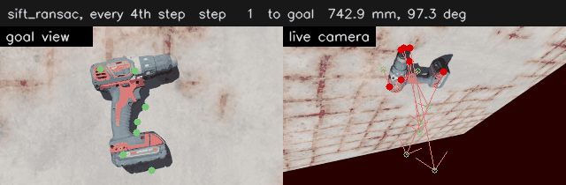
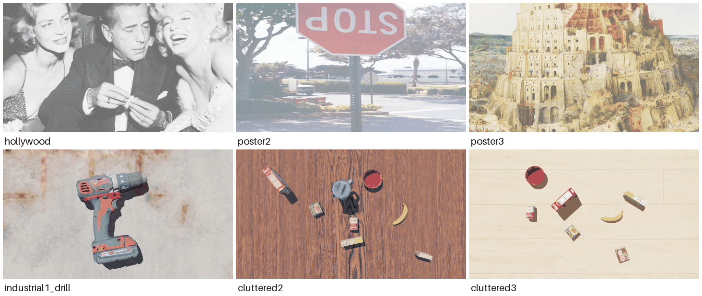
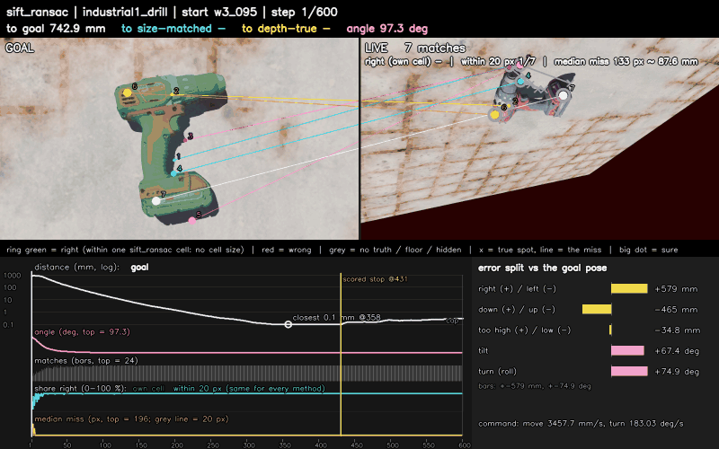

# vs-sim-light

A lightweight simulator for **image-based visual servoing (IBVS)**: a free-flying camera
(an Intel RealSense D435i model, colour + depth, 1920 x 1080) over textured scenes, rendered by
[MuJoCo](https://mujoco.org) on the CPU - no GPU, no Isaac Sim. Plug in your own servoing
method, fly it from fixed start poses, and compare it with published baselines (ViT-VS,
ART-VS, SIFT / ORB / AKAZE).



*`sift_ransac` (no mask) on `industrial1_drill`, from the frozen far start `wide100` / `w3_095`:
743 mm and 97 degrees away from the goal view; 0.3 mm and 0.03 degrees after 600 steps (every 4th step shown).*

## Quick start

**Install** (Linux, Python 3.10+; MuJoCo draws with Mesa's software renderer, from the
`libegl1` and `libgl1-mesa-dri` packages, which are usually present):

```bash
git clone https://github.com/AlessandroScherl/vs-sim-light.git && cd vs-sim-light
python -m venv .venv && source .venv/bin/activate
pip install torch --index-url https://download.pytorch.org/whl/cpu   # the CPU wheel, before the next line
pip install -e ".[mujoco,baselines]"     # baselines: transformers, for vitvs_dinov3
```

**Get the assets.** The pictures and objects are not in the repository (third-party
artwork and scans). The simulator looks for them under `$VSBENCH_WORKSPACE_ROOT/assets/`
(default `~/genvs_ws/assets/`). The three posters need one picture each:

```bash
export VSBENCH_WORKSPACE_ROOT=~/vsbench_data
# $VSBENCH_WORKSPACE_ROOT/assets/hollywood/resized.png  ART-VS's poster (its catkin_ws/ibvs/models/viso/materials/textures/resized.png)
# $VSBENCH_WORKSPACE_ROOT/assets/poster2/poster2.png    the COCO val2017 image 000000000724, saved as PNG
# $VSBENCH_WORKSPACE_ROOT/assets/poster3/poster3.jpg    Bruegel, "The Tower of Babel" (Vienna), Wikimedia Commons, 3840 x 2810
```

The three rooms also need their floor textures and their objects converted into a MuJoCo
cache (`tools/convert_objects.py`, from our USD files and the YCB scans). That USD library
is not public yet: **without it you can fly the three posters**; the rooms need our files.

**Fly a baseline** (one start 3-8 mm from the goal, 100 steps, with a film):

```bash
python -m vsbench fly --scene poster2 --method sift_ransac --start-set near60 --limit 1 --max-iter 100 --film
```

It prints the distance to the goal at the start and at the end and writes everything under
`runs/`; `python -m vsbench list` shows every name you can fly. Flights run on the CPU with two
threads, at roughly 0.5 to 2 seconds per step depending on the method and the machine.

**Weights.** SIFT, ORB and AKAZE need none. `vitvs_dinov3` never downloads: accept the licence of
[facebook/dinov3-vits16-pretrain-lvd1689m](https://huggingface.co/facebook/dinov3-vits16-pretrain-lvd1689m)
and run `hf download facebook/dinov3-vits16-pretrain-lvd1689m` once. `vitvs_dinov2` and `artvs`
load DINOv2 through `torch.hub`, which downloads it on first use (read from the code, untested off our machine).

## Plug in your method

A method is one class (two attributes, four methods) with a `@register` line. It sees the goal
picture, the live picture, depth if it asks for it, and the camera intrinsics - never the true
pose - and returns a camera velocity. [`examples/my_method.py`](examples/my_method.py) is a
complete one (ORB matches and the classic point IBVS law, about 70 lines). Its skeleton:

```python
import numpy as np
from vsbench.methods import register

@register("my_ibvs")                       # the name you pass to --method
class MyIBVS:
    wants_depth = "dense"                  # "none", "scalar" (one distance) or "dense" (a depth image)
    privileged = False                     # must stay False: the benchmark refuses methods that read the pose

    def configure(self, K, width, height, dt):        # once per episode: 3x3 intrinsics (px), size, period (s)
        self.K = K

    def reset(self):                                   # forget the previous episode
        self.goal = None

    def set_target(self, desired_rgb, desired_depth=None, distance_prior=None):
        self.goal = desired_rgb                        # uint8 (H, W, 3); depth is float32 metres, 0 = nothing hit

    def get_control_rate(self, current_rgb, current_depth=None):
        twist = np.zeros(6)                            # [vx, vy, vz, wx, wy, wz] in m/s and rad/s
        return twist, {"error_norm": 0.0}              # the info dict is optional
```

The twist is the camera's velocity in its own frame (x right, y down, z forward): positive
`vz` moves towards the scene, positive `wz` rolls clockwise as seen from behind the camera.
The info dict may carry `kp_cur` and `kp_des` (the matched pixels in the live and the goal
picture, (N, 2) each), `inliers` (N booleans), `error_norm` and `lost` (gave up this step);
with `kp_cur` / `kp_des` the film draws your matches and the benchmark's stopping rule can
run. Constructor arguments come from `--param key=value`. Fly it:

```bash
python -m vsbench fly --scene poster2 --method my_ibvs --plugin examples/my_method.py \
    --start-set near60 --limit 1 --max-iter 150 --film
```

`--plugin` imports your file so that its `@register` line runs; this flight goes from 5.6 mm
to 0.45 mm in 150 steps. Several names fly side by side: `--method my_ibvs sift_ransac`.

## Scenes



| scene | what | start sets |
| --- | --- | --- |
| `hollywood`, `poster2`, `poster3` | a 0.8 x 0.6 m poster seen straight on (ART-VS's poster, a COCO photo, a Bruegel painting) | `near60` (3-8 mm away), `narrow20`, `capped30`, `wide100` |
| `industrial1_drill` | one drill lying on a concrete floor | `capped30`, `wide100` |
| `cluttered2`, `cluttered3` | eight or seven YCB objects on a wooden table or a laminate floor | `capped30`, `wide100` |

The STOP sign in `poster2` is upside down in the COCO photo itself, and that portrait photo
is stretched onto the 0.8 x 0.6 m poster, as in the Isaac Sim benchmark.

The start poses are frozen files (`vsbench/benchmark/starts/`), so every method flies from the
same places. The pictures are tone-mapped to look like the Isaac Sim renders of the same scenes
(`--look raw`: MuJoCo's plain picture).

**Perturbations** (`--perturb`): `light`, `occluder`, `distractors`, `noise`, `combined`,
`ground:<floor>` and `swap:<object>` (replace an object with one of the 317 converted library
objects: shoes, bottles, mugs, drills, ...), chained with `+`, e.g.
`--perturb swap:ycb/006_mustard_bottle+ground:concrete`. The goal view stays the unperturbed one.

## Masks

`--mask` keeps only the matches whose point in the goal picture lies inside a mask:

```bash
python -m vsbench fly --scene industrial1_drill --method sift_ransac --start-set capped30 --limit 1 --mask objects
python -m vsbench fly --scene poster2 --method sift_ransac --start-set near60 --limit 1 --mask my_mask.png
```

`objects` is the goal picture's objects, found from the goal depth (everything above the
floor); it is the benchmark's labelled `objmask` cell, and only works in the rooms. A `.png`
is your own mask on the goal picture (white = keep; another size is resized). The run's
name and label then say `objmask` or `filemask-<md5>`, and each record says where the mask
came from (`goal_mask_source`). Your own method receives the mask if its `set_target` has a
`goal_mask=None` argument (a True/False array the size of the goal picture);
`vsbench.methods.mask_matches(kp_des, kp_cur, goal_mask)` tells which matches to keep, as
`examples/my_method.py` does. A method without that argument is refused a mask.

## Debug visualizations

- **The film** (`--film`): goal | live camera, the matched points with an arrow from each to
  its target, the step, the number of matches and the true distance to the goal (the GIF above).
- **The debug view** (`--debug-gif`, below: the flight above, every 8th step): each goal point joined
  to its live match and checked against the true correspondence (the header counts the matches
  within 20 px of the truth), the timeline of the whole flight (distance, angle, matches, where
  each stop fired) and the error split into sideways, height, tilt and roll. `--debug-gif` writes
  one `debug.gif` per episode next to its film (`vsbench/vs/bench/debugview.py`, animated).



## What you get from a run

`runs/<scene>_<name>.jsonl` holds one JSON record per episode (your own methods carry an
`external_` tag: `poster2_external_my_ibvs.jsonl`). Read `final_translation_mm`
and `final_rotation_deg` (the true distance to the goal pose when the episode ended), next to
`start_translation_mm`, `steps` and `terminated_reason`; `success` says yes or no per rule
(e.g. `abs_10mm_1deg`: within 10 mm and 1 degree). Beside it, a dated run directory under
`runs/<scene>_<name>/` holds the run's settings, machine and commit (`run.json`,
`resolved_config.yaml`) and, with `--film`, one `episode.mp4` per episode (the record's `film`
field gives its path; `--debug-gif` adds `debug.gif` beside it, field `debug_gif`). `--telemetry` adds a per-step log, and
`python -m vsbench.world.fly summary --out runs` prints a table of a whole directory.

## Baselines included

Copied unchanged from our Isaac Sim benchmark and run as published. Here they run on the CPU
with a software renderer and the Isaac look, so their numbers are not the same as Isaac Sim
numbers and should not be pooled with them.

- **ViT-VS** (`vitvs_dinov3`, `vitvs_dinov2`): Scherl et al., [arXiv 2503.04545](https://arxiv.org/abs/2503.04545)
- **ART-VS** (`artvs`): [art-vs.github.io](https://art-vs.github.io/), [arXiv 2606.19089](https://arxiv.org/abs/2606.19089)
- **SIFT / ORB / AKAZE** (`sift_ransac`, `orb_ransac`, `akaze_ransac`): [OpenCV](https://opencv.org) features, RANSAC and the point IBVS law
- **CNS v1** ([hhcaz/CNS](https://github.com/hhcaz/CNS)): the code is copied but not wired up yet

## Further reading

- [`docs/PORT_NOTES.md`](docs/PORT_NOTES.md): developer notes (the renderer, the camera
  motion, the test loop, the gates, how the Isaac Sim benchmark was copied, the look)
- [`docs/PORT_PLAN.md`](docs/PORT_PLAN.md): the plan of the port from Isaac Sim
- [`vsbench/vs/PROVENANCE.md`](vsbench/vs/PROVENANCE.md): what was copied, from which commit
- [`docs/`](docs/): the three step briefs (`STEP1_RENDERER_BAKEOFF.md`, `STEP2_CAMERA_MOTION.md`, `STEP3_SERVO_LOOP.md`); their reports are in `results/`

MIT licence.
